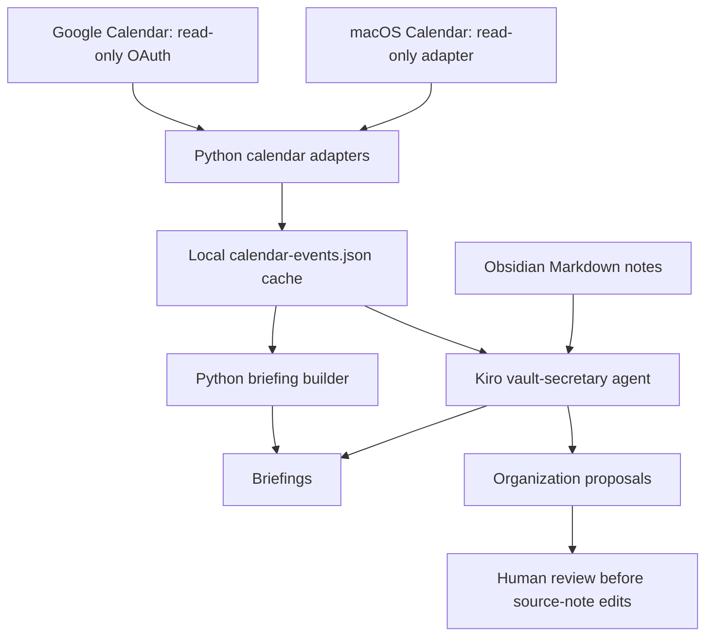

# Vault Secretary

A local, calendar-aware assistant for an Obsidian vault. Python scripts collect upcoming events and prepare briefing material; a Kiro agent uses that cache and Markdown notes to draft briefings and organization proposals.

**Status:** Google Calendar OAuth and a macOS Calendar adapter are included as alternative read-only sources. Source-note edits require approval; the assistant does not edit calendar events.

## Architecture

## Start here

Install the Python requirements and configure the local environment as described in the reference guide. Run the selected calendar sync script, then `python scripts/build_briefing.py`. Start Kiro from the vault root with `kiro-cli --agent vault-secretary`. See [scripts/](scripts/) and [.kiro/agents/vault-secretary.json](.kiro/agents/vault-secretary.json) for the implementation and permission model.

[Previous README and detailed reference](https://github.com/mtzanida/vault-secretary/blob/98e5b2d9f244a505b5dfd70f12f5cc9c21ebdcd4/README.md) are retained in Git history. They may describe older assumptions or unmerged plans; the scope above reflects this branch.
